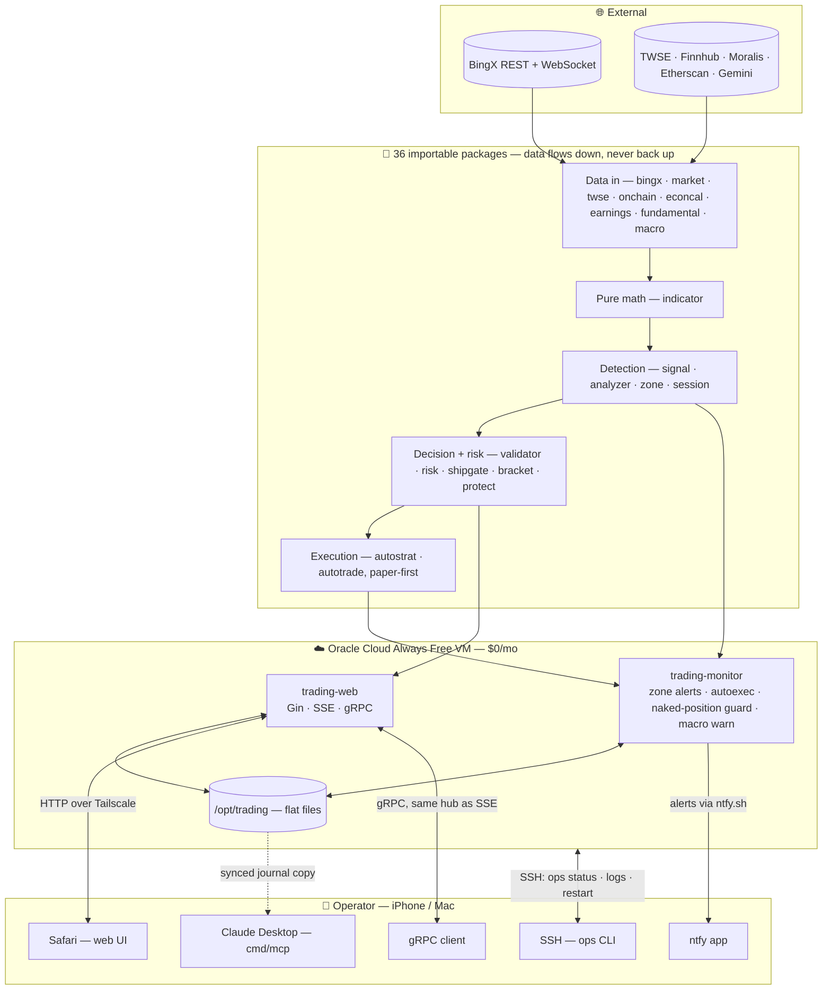
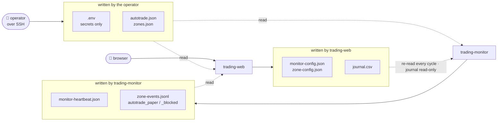
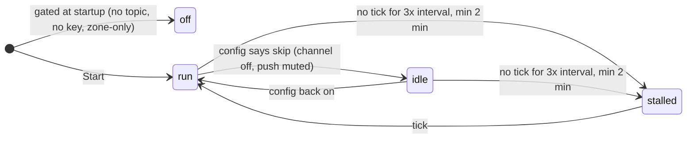
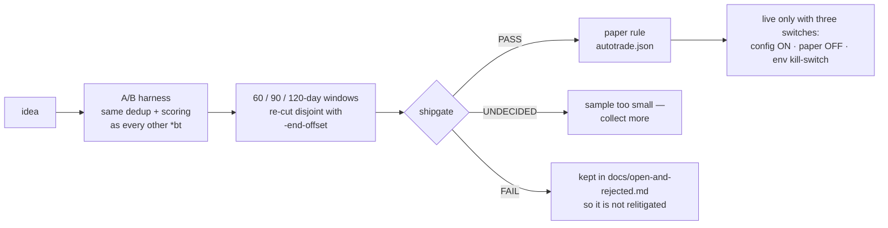

# trading-bot — multi-strategy crypto signal engine in Go

A confluence-based signal engine, backtester and live monitor on BingX
perpetuals, running 24/7 on a $0/month Oracle Cloud VM. It detects named
market events, scores a setup, records trades, executes paper-first, and
pushes alerts to a phone. The daemon universe is **BTC, ETH, XAU, XAG**; the
CLIs and the web UI address any of the 14 contracts `market.Resolve` knows.

> 🇹🇼 **繁體中文版 → [`README.zh-TW.md`](README.zh-TW.md)**

> **A research tool, not financial advice.** It places real orders against a
> real exchange. Every strategy in it was measured before shipping, and several
> were measured and rejected — that record is in [`docs/open-and-rejected.md`](docs/open-and-rejected.md).

---

## At a glance

| | |
|---|---|
| **Runs** | Two systemd services on one Oracle Cloud Always Free VM (1 GB RAM), reachable only over Tailscale and SSH |
| **Does** | Detect → score → record / execute (paper-first) → alert |
| **Discipline** | Every strategy change goes through a 60/90/120-day A/B, and the ship gate is code (`shipgate`), not a habit |
| **Size** | 36 importable packages + 28 commands · 255 Go files, 83 of them tests · ~55k lines · `go test -race ./...` clean |
| **Ships as** | `FROM scratch` images (web 28.7 MB, monitor 7.4 MB) built by CI per commit, deployed with Docker Compose behind a manual approval ([`docs/operations.md`](docs/operations.md#deploying)) |

---

## Architecture



## On the VPS: who reads and writes what

Two processes and an operator share one data directory. The arrows are the
design: the web service writes **configuration files and the journal — never
`.env`, never a unit.**



The full table, with every file, is in [`docs/operations.md`](docs/operations.md#the-data-directory).

## The web service holds no host privileges

The web service is the most exposed process and holds the exchange keys. What
it could do to the host, before and after moving service control to SSH:

| Capability | Before | Now | Moved to |
|---|:---:|:---:|---|
| Rewrite `.env` (the file holding the keys) | ✅ | ❌ | runtime settings in `monitor-config.json` |
| `sudo systemctl start / stop / restart` | ✅ | ❌ | `ssh trading-bot ops restart …` |
| Read the host journal | ✅ | ❌ | `ops logs …`; zone events in their own file |
| Read-only `systemctl is-active` | ✅ | ❌ | the monitor's heartbeat, after a one-day side-by-side |

The web binary no longer imports `os/exec` at all: it needs nothing from the
host, which is what lets it move into a container.

## Monitor heartbeat

Each monitor loop reports itself — `Start`, a `Tick` per cycle, `Off` with a
reason — and the monitor rewrites `monitor-heartbeat.json` every 15 seconds
(temp file + rename, so a reader never sees half a file). The reader only
judges freshness:



A file older than 60 seconds means the whole daemon is down, whatever the loops
say. `stalled` is the case `systemctl is-active` cannot see: the process is
alive, one goroutine is stuck.

## How a strategy change ships



`shipgate` judges **every window separately**, not the aggregate, lists every
failed criterion rather than the first, and has an **absolute floor** — median
R/trade must clear zero however the baseline did — because a purely relative
gate cannot say "neither of these should be traded". FVG continuation is the
latest example: it beat the baseline in all three windows and still failed.

---

## Engineering decisions & tradeoffs

| Decision | Why this not that |
|---|---|
| **gRPC server lives *inside* `cmd/web`, not its own binary** | `tickerHub` owns the single BingX mark-price websocket **per process**. A separate `cmd/grpc` could not attach to it — it would open a second websocket and a second REST poller, so "what is BTC right now" would have two answers that drift. "Reuse the hub" and "separate process" are mutually exclusive here, so the gRPC listener is opt-in via `GRPC_BIND` inside the web process (unset = no listener, no signal handler, zero behavior change). gRPC is a second **transport**, not a second data path. |
| **`Drain()` before `GracefulStop()`, not `GracefulStop()` alone** | `GracefulStop` waits for in-flight RPCs to finish — but `StreamMarkPrices` only ends when the *client* leaves, so one healthy subscriber blocks shutdown **forever**. Two phases instead: close a drain channel so every stream returns `UNAVAILABLE` (the code gRPC clients retry on), then `GracefulStop` to flush in-flight unaries and GOAWAY. Still bounded at 15s then hard `Stop()` — a shutdown that can hang is one systemd will `SIGKILL` anyway. `Stop()` alone would cut frames mid-write; on a long-lived feed that is the whole difference. |
| **Browser keeps SSE; gRPC is for services** | Browsers cannot speak gRPC without `grpc-web` plus a proxy, so moving the UI would add a hop to serve a client that was already well served. Both read the same hub, so an SSE tab and a gRPC consumer are guaranteed to see the same number from the same upstream connection. |
| **Containerized, but production deliberately does not run Kubernetes** | The image earns its place: a multi-stage build to `FROM scratch` lands at **27 MB** — static binary, no shell, no libc, with the CA bundle copied in from the builder. That last part is not optional and not obvious: an image without it still answers `/health` with 200 and still serves `/api/tickers`, while every outbound TLS call fails `x509: certificate signed by unknown authority` and the economic calendar silently degrades to embedded data. Cheap rebuilds are the actual goal, and the image delivers that. Kubernetes is a separate question with a different answer: three binaries on one host, one operator, no autoscaling and no rolling-update requirement — a single-node cluster adds a control plane, etcd and a CNI to maintain and returns none of what it exists for. The manifests in [`k8s/`](k8s/) are there to pin down probe semantics, not to be deployed (walkthrough: [`k8s/README.md`](k8s/README.md)). `/health` is **liveness** and must never consult a dependency — a liveness probe that checks BingX converts their outage into our `CrashLoopBackOff`, verified by pointing it at a 404 and watching `RESTARTS` climb 0→1→2 every ~32s. `/readyz` is **readiness**, which may. The first `/readyz` gated on `hub.Running` and deadlocked: the hub is lazy, so `Running` means *someone is watching the SSE stream*, not *this service is healthy* — no traffic meant never ready meant no traffic. Readiness asks whether we **can** serve, not whether we **are**. |
| **Sweep close-confirmed invalidation, not just wick-pierced** | The original sweep detector fired on wick-pierce, then never re-evaluated. Backtest revealed it kept emitting LONG signals during the XAG −2.4% dump on 2026-05-27 (stale sweep from earlier bar). Fix: kill the sweep the moment any later candle closes through the swept level in the wrong direction. Result: aggregate **netR +10.91R → +19.97R (+83%)** across 60d on 1h. |
| **HVN / Volume Profile as display-only, NOT a vote** | Intuition said "trade with the chip zone" — but backtest showed enforcing HVN as a confluence vote dropped net edge by diluting score thresholds with marginal setups (BTC −1R, Silver −5.8R). Kept HVN computed and surfaced as `·` lines for trader judgment; engine doesn't vote on it. The discipline of "let the backtest decide" beat the discipline of "trust the intuition." |
| **MTF bias filter behind an opt-in flag (`-bias`)** | Same story: backtest showed enforcing higher-TF MACD direction hurt ETH mean-reversion edge (+6.5R → −2.4R). Made it opt-in for experimentation rather than removing it entirely — preserves the ability to A/B with future data. |
| **Stop refinement (push past HVN clusters) opt-in via `-stop-refine`** | Backtest showed wider stops shrink R-multiples within the 24-bar hold (more timeouts at small loss, fewer 2R winners). BUT the simulator can't model real stop-hunt slippage. Opt-in flag preserves both schools of thought; live data via journal will decide. |
| **Confluence VOTE model, not weighted sum** | Each factor casts ≤1 vote per direction per bar, score = max(bull, bear). Simpler than weighted-sum (fewer hyperparameters to tune, less curve-fitting risk on small samples), and the vote count is interpretable (`LONG(3)` = three independent factors agreed). |
| **CSV journal, not SQLite/Postgres** | One process writing append-mostly rows, edited by hand through the web UI. SQLite would force schema migrations as a tool; with CSV I version the schema by column count (v1→v9, currently 30 cols) and auto-migrate on first read. Tradeoff: no concurrent writers, no complex queries — but those don't apply here. |
| **Web UI binds to Tailscale IP, NOT 0.0.0.0** | Three-layer defense (Tailscale CGNAT + ufw + bind-address) — any single breach still leaves two layers intact. No app-level auth needed because the network layer already enforces identity via Wireguard. Senior platform engineering: trust the network primitive when it's strong, don't bolt on weak auth as security theater. |
| **Range expansion bars: voted, demoted, re-promoted** | Originally a vote; demoted to display-only after symbol-regime dependence showed up in one backtest; **re-promoted after an XAG case** where the engine gave a 9.0/10 LONG while a 3-ATR bearish range-expansion bar was being detected but ignored. Subsequent 60-day backtest validated: XAG flipped −8.65R → +0.66R. Lesson: a single backtest window is noisy; revisit decisions when new evidence shows up. |
| **Service control on SSH, not in the web app** | The web service is the most exposed process and holds the exchange keys. It used to restart units with `sudo`, rewrite `.env` to mute pushes, and read the host journal. All three moved out: restarts and logs to `ops` over SSH (Tailscale + key + passphrase — a stronger door than a web page), muting to a runtime config file. The `/ops` page now changes settings, never processes. |
| **A heartbeat the daemon writes, not `systemctl is-active` and not inference** | `/ops` used to decide which monitor loops were "on" by re-reading `.env` and re-deriving the monitor's gating — two copies of the same rules, kept in sync by hand. They drifted: a zone card read ON for a full day while the loop short-circuited every cycle. Now each loop reports itself; the reader only judges freshness. It also sees what systemd cannot: a process that is alive while one goroutine is stuck in a network call. It ran beside the old card and systemd for a day, sampled every 10 minutes — 103 samples, 0 disagreements — before both were removed. |
| **Runtime settings in a file the daemon re-reads, secrets in `.env`** | Same pattern the zone channel already used. A mute is now a JSON flag read on every send — no restart, and the web never needs write access to the file holding the keys. A config that fails to parse leaves push **on**, because the naked-position alarm shares the channel. |

## Production learnings

| Issue | Diagnosis | Fix |
|---|---|---|
| **Daemon timestamps drifting 8h from systemd's** | Go binary defaulted to UTC for `log.Printf`, systemd's journal prefix was Taipei (after `timedatectl set-timezone`). Same line split across two timezones. | `Environment=TZ=Asia/Taipei` in the systemd unit — pass timezone into the process, not just system-wide. |
| **Closing iPhone Terminal# killed the daemon** | Running the (now retired) `cmd/serve` in the foreground inherited the SSH session's controlling terminal; SIGHUP propagated on disconnect. | `nohup` + `disown` then, systemd units now — a process an operator starts by hand is a process that dies with the operator's session. |
| **Stale sweeps continuing to fire during structural breakdowns** | The `LONG score=2 on XAG during −2.4% dump` incident. Sweep detection didn't re-evaluate after the swept level got reclaimed in the wrong direction. | Sweep-invalidation logic: any later candle closing through the swept level in the wrong direction kills the sweep. Documented in [`signal/engine.go`](signal/engine.go) and validated by the +83% backtest improvement. |
| **`journal.csv` lost web-write access after `sudo` edit on VPS** | Editing the file as root flipped ownership to `root:root`; the `ubuntu`-running web daemon could no longer append. | Reflex `chown journal.csv ubuntu:ubuntu` after any `sudo`-touched rewrite; a checklist item now. |
| **Backtest reported edge that didn't appear live** | Look-ahead bias — early version used current-bar high/low for sweep detection (information not yet available at the alert moment). | Added "drop forming candle" helper so live and backtest both see identical inputs at the alert moment. |
| **The panel reported a loop ON for a full day while it did nothing** | The loop card inferred state from `.env` and had no idea a second gate (`zone-config.json` `enabled`) short-circuited every cycle. | The monitor now writes a heartbeat; see *Engineering decisions*. Testing the side-by-side caught two more inference errors before it was even deployed. |
| **A deploy nearly shipped another session's uncommitted code** | `make deploy-*` compiles the working tree. It held unreviewed order-sizing work, including an untracked `.go` file — compiled in, invisible to `git diff`. Caught by checking timestamps by hand. | `guard-clean`: every deploy refuses a dirty tree and lists the files. Deploy a commit from a clean `git worktree`. |

---

## Repository map

| Layer | Packages | Responsibility |
|---|---|---|
| **Data in** | `bingx` (REST + WebSocket + paginated klines), `market` (Symbol/Candle types, 14 contracts incl. NCCO* metals and NCSK* stock synthetics), `twse`, `onchain`, `econcal`, `earnings`, `fundamental`, `macro`, `dxy` | Every external read. `market.Resolve` is the single symbol map — the canonical one, after three stale copies caused outages. |
| **Pure math** | `indicator` | Stateless: RSI, BOLL, MACD, ATR, Fibonacci, volume profile (HVN/POC). No I/O, no clock. |
| **Detection** | `signal` (confluence voting, N字 BOS/CHoCH structure, EQH/EQL liquidity pools, session opens, shelves), `analyzer` (sweep + reclaim, divergence, CVD, double patterns), `zone` (pivot-zone bands, manual + auto-derived), `session` (US cash-open bar modelling) | Turns candles into named events. **Closed bars only** — the forming bar is never read, which is what keeps live and backtest identical. |
| **Decision + risk** | `validator` (/10 discretionary score), `risk` (notional/equity, kill distance), `shipgate` (PASS/FAIL/UNDECIDED), `bracket` (naked-position guard), `protect` (stop management) | Scores a proposal and refuses bad ones. `shipgate` is the notable one: the ship criteria are CODE, not a habit — see below. |
| **Execution** | `autostrat` (rule → trigger), `autotrade` (paper fires, dedup into one-position-per-rule, global caps) | Paper-first and non-negotiably so. Live requires config master ON, paper OFF, **and** an env kill-switch. |
| **Record** | `journal` | 30-column CSV, versioned by column count, auto-migrating v1→v9 on read. |
| **Output** | `notify` (stdout / macOS / ntfy fan-out), `ansi`, `ai` (Gemini/Anthropic, dry-run aware) | |
| **Config + runtime** | `config` (`.env` loader), `monitorcfg` (settings the panel changes at runtime), `heartbeat` (loops' self-reported state) | Every data path is env-overridable, which is what makes a fixture-backed demo instance cheap. |

| Commands (28) | |
|---|---|
| **Services** (systemd on the VPS) | `web`, `monitor` — `serve`, the original alerter, is retired and no longer deployed |
| **Read / analyse** | `analyze`, `validate`, `price`, `contracts` |
| **Account / exchange** | `acct`, `protect`, `wsprobe` |
| **Data fetchers** (cron) | `earnings-fetch`, `fundamental-scan` |
| **Record** | `journal` |
| **Integration** | `mcp` — MCP server over a synced journal copy, for Claude Desktop |
| **Simulator** | `backtest` |
| **Research** | 12 A/B harnesses + `gate` — below |

### Research harnesses

Each exists because a specific question could not be answered by the one
before it:

| Harness | The question |
|---|---|
| `sweepbt` | sweep-reject parameter surface (the shipped edge) |
| `snrbt` | higher-timeframe S/R fade — puts the `htf-snr` rule through the gate |
| `rangebt` | range-edge arms, incl. side and event filters |
| `breakbt` | break-and-retest |
| `confirmbt` | touch entry vs close confirmation (answer: close, −0.12R/trade vs −0.41R) |
| `flipbt` | polarity flip after a level breaks |
| `fvgbt` | FVG / imbalance continuation — **failed** 2026-10-07 |
| `openbt` | does session-open alignment predict outcome (bucket split) |
| `opensab` | the same question done properly — filter at fire-generation, then `shipgate` |
| `basebt` | baseline, so an arm always has something to beat |
| `shadowbt` | EQH/EQL/open levels as shadow signals |
| `shelfbt` | shelf-retest — **rejected**, the surface has no peak |

### Tech stack

| Layer | Choice |
|---|---|
| Language | **Go 1.25** — static binaries, trivial cross-compile |
| Web | Gin + `html/template`, server-rendered, no JS framework; assets via `//go:embed` |
| Service API | **gRPC** — unary + server-streaming on the same hub as SSE ([`docs/grpc.md`](docs/grpc.md)) |
| Persistence | Flat files: CSV journal (auto-migrated v1→v9, 30 columns), JSON config, JSONL event logs |
| Push | ntfy.sh, behind a pluggable `Notifier` with `Multi` fan-out and a runtime mute |
| Network | Tailscale (WireGuard mesh); web bound to the Tailscale IP, not `0.0.0.0` |
| Hosting | Oracle Cloud Always Free — $0/month |
| Supervision | Docker Compose, `restart: unless-stopped`; deployed by GitHub Actions; operated through `ops` over SSH |
| Container | Multi-stage → `FROM scratch`, **27 MB** |
| Orchestration | Compose on one host in production; [`k8s/`](k8s/) manifests pin down probe / resource / `GOMEMLIMIT` semantics |

---

## Quick start

```bash
make                         # all targets
make check                   # vet + test -race + lint
make analyze 1h              # engine snapshot, the 4 daemon symbols
make validate BTC long 74500 1h
make backtest 60 1h          # 60-day replay with the fee model
make grpc && make grpc-probe # gRPC listener + a grpcurl smoke test
```

Raw flags and every tool: [`docs/cli.md`](docs/cli.md). Deploying and running
it: [`docs/operations.md`](docs/operations.md).

## Documentation

| Doc | What |
|---|---|
| [`docs/operations.md`](docs/operations.md) | VPS layout, data directory, deploys, `ops`, push, web UI routes, security model, backups |
| [`docs/cli.md`](docs/cli.md) | Every CLI tool, its flags, and how to read the output |
| [`docs/strategy.md`](docs/strategy.md) | Confluence factors, the original backtests, HVN as a trading overlay |
| [`docs/open-and-rejected.md`](docs/open-and-rejected.md) | What is open, and what was measured and rejected |
| [`docs/grpc.md`](docs/grpc.md) | gRPC MarketData design (zh-TW) |
| [`k8s/README.md`](k8s/README.md) | Container + Kubernetes: probes, `GOMEMLIMIT`, why production does not run K8s |
| [`docs/architecture_hardening.md`](docs/architecture_hardening.md) | Durability plan after the 2026-10 lockout |
| [`docs/ssh_recovery_runbook.md`](docs/ssh_recovery_runbook.md) | SSH incident record |
| `docs/auto_executor_design.md` · `price_stream_design.md` · `AI_ARCHITECTURE.md` · `ai_fanout_design.md` · `struct_momentum_strategy_design.md` · `fundamental_f3_earnings_spec.md` · `ui_overhaul_plan.md` · `MCP_SETUP.md` | Point-in-time design records — read for the reasoning, check the code for current behaviour |

Some packages carry their reasoning in the package doc instead:
`session/session.go` (why the 9:30 ET bar has its own package),
`autotrade/caps.go` (why zero means unlimited), `heartbeat/heartbeat.go`,
`monitorcfg/monitorcfg.go`.

## Caveats

- **It places real orders.** The auto-executor is paper-first and going live
  needs three switches; a bundled stop can fail to attach silently, so every
  entry is re-checked against the exchange (`/ops/verify`) and a server-side
  guard watches for naked positions — because that failure actually happened.
- **No slippage or funding model** in the backtester; limit fills are assumed.
- **Samples are small** — tens of trades per symbol per window, so confidence
  intervals are wide. `shipgate`'s sample floor returns UNDECIDED rather than
  pretending otherwise.
- **No liquidation-heatmap provider** — the interface exists, no live source.

## License

[MIT](LICENSE) — Copyright (c) 2026 Henry Yeh. Use it, fork it, learn from it.
It carries no warranty, and it is a research tool, not financial advice.
