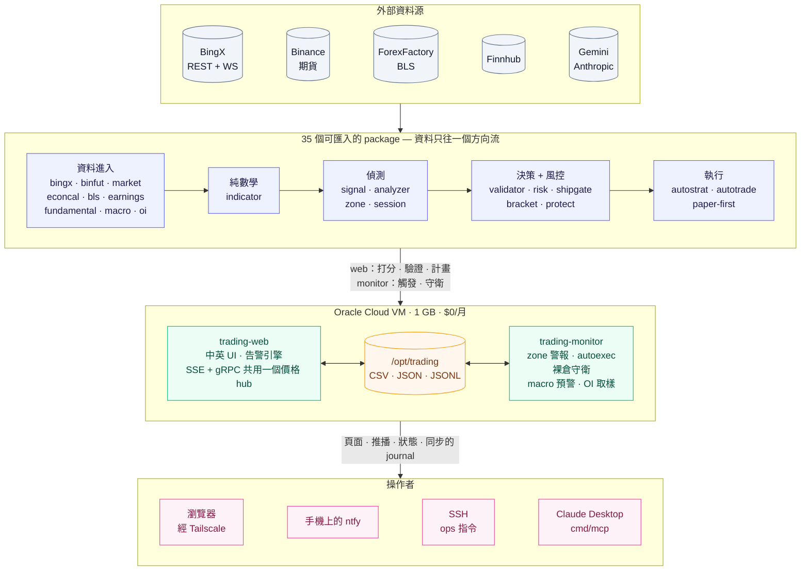
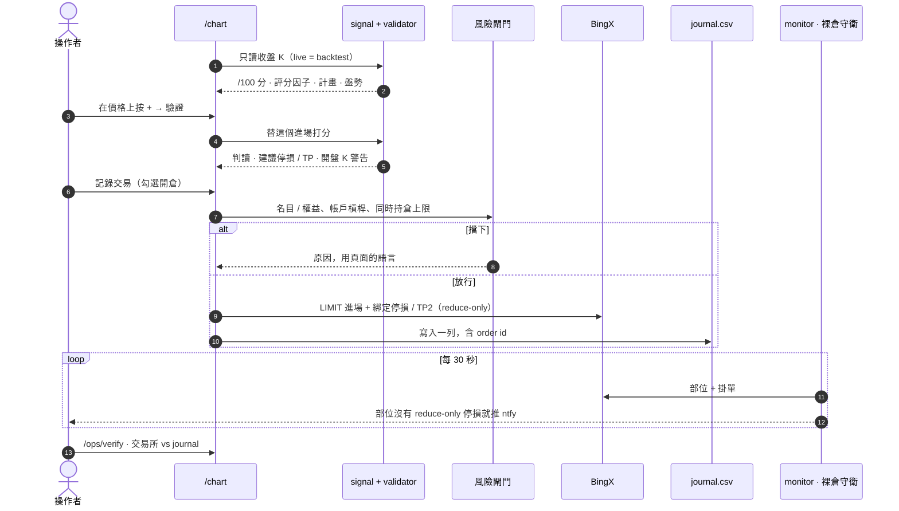
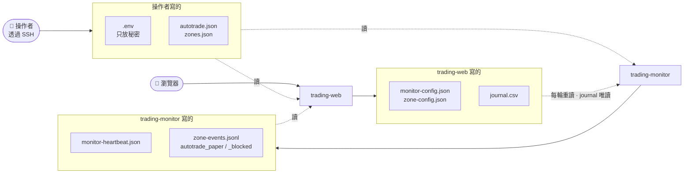
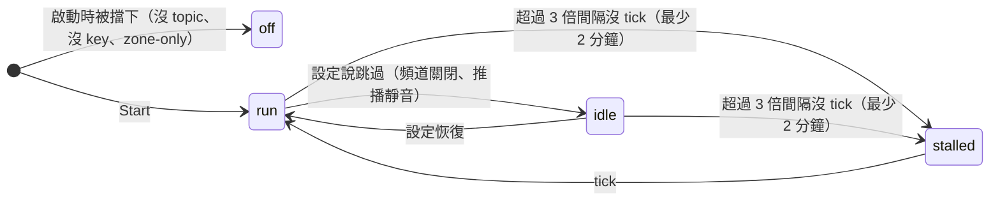
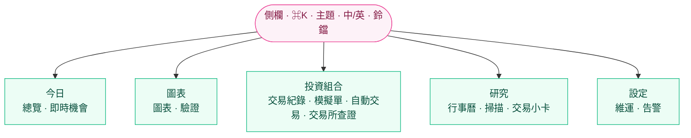
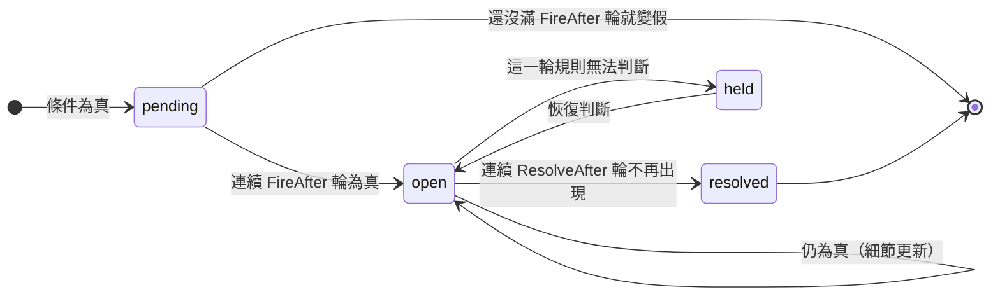
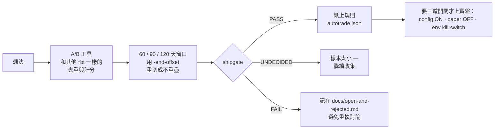
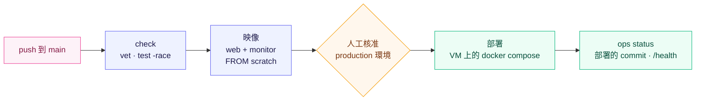

# trading-bot — 以 Go 寫的多策略加密貨幣訊號引擎（繁中版）

> 本檔是 [`README.md`](README.md) 的繁體中文版，章節一一對應。技術名詞（sweep /
> confluence / ship gate / EQH / POC / heartbeat 等）保留原文。`> 💡` 開頭的段落是
> **譯註**，英文版沒有，用來補「為什麼這樣做」的背景。
>
> 操作文件（`docs/operations.md`、`docs/cli.md`、`docs/strategy.md`）維持英文：
> 那些內容本身大多是指令和表格，翻譯不會讓它更好懂，只會多一份要同步的東西。

一個以 confluence 為核心的訊號引擎、回測器與即時監控，標的是 BingX 永續合約，
24 小時跑在一台 $0/月的 Oracle Cloud VM 上。它偵測有名字的市場事件、給進場打分、
記錄交易、paper-first 地執行，並推播到手機。Daemon 監控 **BTC、ETH、XAU、XAG**；
CLI 和 web UI 可以指定 `market.Resolve` 認得的全部 14 個合約。

> **這是研究工具，不是投資建議。** 它會對真的交易所下真的單。每個策略上線前都量測
> 過，也有好幾個量測後被否決 —— 紀錄在 [`docs/open-and-rejected.md`](docs/open-and-rejected.md)。

---

## 一眼看完

| | |
|---|---|
| **跑在哪** | 一台 Oracle Cloud Always Free VM（1 GB RAM）上的兩個容器（Docker Compose），只能透過 Tailscale 和 SSH 連到 |
| **做什麼** | 偵測 → 打分 → 記錄／執行（paper-first）→ 推播 |
| **紀律** | 每個策略改動都要過 60/90/120 天的 A/B，而且上線閘門是程式（`shipgate`），不是習慣 |
| **規模** | 35 個可匯入的 package + 28 個 command · 253 個 Go 檔，其中 87 個是測試 · 約 55k 行 · `go test -race ./...` 乾淨 |
| **怎麼出貨** | `FROM scratch` 映像（web 28.7 MB、monitor 7.4 MB），CI 依 commit 建置，人工核准後用 Docker Compose 部署（[`docs/operations.md`](docs/operations.md#deploying)） |

> 💡 這個專案真正的重點不是「會不會賺錢」，而是**每一個策略改動都要通過 60/90/120 天
> 的 A/B 才能上線**，而那個閘門是寫成程式的。下面「策略怎麼上線」和「研究工具」兩節
> 是整個 repo 最不尋常的地方。

---

## 架構

顏色代表角色：**灰色**是外部世界，**靛藍**是可匯入的 package（資料只往下流，不回頭），
**綠色**是兩個常駐服務，**橘色**是磁碟上的狀態，**粉紅**是操作者。



### 從一根收盤 K 到一個有防護的部位

這是操作者在 `/chart` 上走的手動路徑。每一個會拒單的關卡都在送到交易所**之前**；
成交之後被檢查的是交易所，不是 journal。



> 💡 最後兩步是這張圖的重點。綁定的停損曾經**靜默地沒掛上**，journal 卻寫著
> ATTACHED。所以成交之後信的是交易所：守衛每 30 秒去問交易所，查證頁也是直接讀交易所。

## VPS 上：誰讀、誰寫哪個檔案

兩個 process 和一個操作者共用一個資料目錄。箭頭本身就是設計：web 服務只寫
**設定檔和 journal —— 從不寫 `.env`，也從不重啟任何服務。**



列出每一個檔案的完整表格在 [`docs/operations.md`](docs/operations.md#the-data-directory)。

## web 服務不持有任何主機權限

web 是整個系統裡最常接觸外部輸入的 process，而且存著交易所的 API key。把服務控制搬到
SSH 前後，它對主機能做的事：

| 能力 | 之前 | 現在 | 搬去哪 |
|---|:---:|:---:|---|
| 改寫 `.env`（存 API key 的檔案） | ✅ | ❌ | 執行期設定放 `monitor-config.json` |
| `sudo systemctl start / stop / restart` | ✅ | ❌ | `ssh trading-bot ops restart …` |
| 讀主機的 journal | ✅ | ❌ | `ops logs …`；zone 事件有自己的檔案 |
| 唯讀的 `systemctl is-active` | ✅ | ❌ | monitor 的心跳，並排觀察一天之後 |

web 的程式現在完全沒有匯入 `os/exec`：它不需要主機提供任何東西，這也是它能放進容器的前提。

> 💡 這叫**最小權限原則**。就算目前只有一個人在操作，把維運權限從 web 拿掉還是值得：
> 重點不是「誰來操作」，而是「權限放在誰身上」。web 一旦有 bug 或被打穿，攻擊者拿到的
> 只剩 web 自己，而不是連帶整台主機的控制權。公司裡的內部管理後台也一樣，通常是獨立
> 的服務、獨立的登入。在這裡，SSH（Tailscale + 金鑰 + 密碼）就是那個管理後台。

## Monitor 心跳

monitor 的每個迴圈自己回報 —— 啟動時 `Start`、每一輪 `Tick`、因設定沒啟動時 `Off`
加原因 —— monitor 每 15 秒把整份狀態寫到 `monitor-heartbeat.json`（先寫暫存檔再
rename，讀的一方永遠不會讀到寫一半的檔案）。讀的一方只判斷新鮮度：



整個檔案超過 60 秒沒更新，代表整個 daemon 掛了，不管迴圈怎麼寫。`stalled` 是
`systemctl is-active` 看不到的情況：process 還活著，但某個 goroutine 卡住了。

> 💡 心跳取代的不只是 `systemctl`，還有原本的**推測**。`/ops` 以前是重讀 `.env`、
> 再模仿一次 monitor 的啟動邏輯，去「猜」哪些迴圈在跑 —— 兩份邏輯靠人工保持同步。
> 它們真的不同步過：zone 頻道被關掉時，那張卡片顯示 ON 整整一天。讓 daemon 自己說，
> 推測的那份就可以整個刪掉。

## Web app

五個區塊，每個區塊底下是幾個分頁；每一頁的頂端都有告警鈴鐺。頁面在伺服器端依兩份字典
渲染成中文或英文 —— 沒有前端翻譯層，也不會有中英混雜的頁面。



- **伺服器端 i18n，有測試把關。** 模板用了不存在的 key、兩份字典的 key 對不上、或某個
  格式字串在兩種語言裡帶的參數數量不同，測試都會失敗。
- **訊息帶的是代碼，不是句子。** 風控拒單、開盤 K 停損警告、protect 的拒絕原因、下單
  結果都是「代碼 + 數值」，頁面用自己的語言渲染；英文字典由測試鎖定成和 CLI 印出來的
  句子一字不差。
- **兩個主題，一種版面。** 深色和淺色只差顏色 token。

## 告警

web 服務每 15 秒評估一次規則，把「這一輪為真的狀況」交給告警引擎。之後的事都歸引擎管：
同一個 key 只會有一個事件、用遲滯避免數值在門檻附近來回跳、每一次變化都 append 到一個
JSONL 檔，啟動時從它重建狀態。



確認（ack）不等於解除：確認過的告警會一直開著，直到條件真的消失。critical 等級的告警在
觸發和解除時也會推到手機 —— 只有「monitor 掛了」例外，因為 `daemon-watch` 已經從兩個
容器之外推過一次；同一個故障推兩次，只會讓人學會兩個都忽略。規則：[`docs/alerts.md`](docs/alerts.md)。

> 💡 告警取代的是「狀態頁」。狀態頁只有在有人看的時候才有用；事件會記下什麼時候開始、
> 持續多久、有沒有人看到。凌晨 3 點裸倉守衛卡住 4 分鐘，到 3:05 狀態頁上已經看不出來，
> 告警會留著。

## 策略怎麼上線



`shipgate` **逐窗口判斷，不看聚合**，列出**每一條**沒過的條件而不只是第一條，並且有
**絕對地板** —— 中位數 R/trade 必須大於零，不管基準線表現如何 —— 因為純相對的閘門說不出
「這兩個都不該交易」。FVG continuation 是最近的例子：三個窗口都贏基準線，還是 FAIL。

> 💡 最後那條是整包東西的重點。一個**純相對**的閘門只會挑出比較不爛的那個；絕對地板
> 就是為了讓它能說「都不要」而加的。

### 程式怎麼上線



較新的 push 會取消還在等核准的那次執行，而且兩個部署不會同時跑，所以上到生產環境的
一定是最新一個被核准的 commit —— `ops status` 會印出是哪一個。

---

## 工程決策與取捨

| 決策 | 為什麼是這個而不是那個 |
|---|---|
| **gRPC server 放在 `cmd/web` 裡，不是獨立 binary** | `tickerHub` 在**每個 process** 擁有唯一一條 BingX 標記價格 websocket。獨立的 `cmd/grpc` 接不到它 —— 它得再開第二條 websocket 和第二個 REST poller，於是「BTC 現在多少」會有兩個會漂移的答案。「共用 hub」和「獨立 process」在這裡互斥，所以 gRPC listener 是 web process 內用 `GRPC_BIND` 開啟的選項（不設就不建立 listener，行為完全不變）。gRPC 是第二種**傳輸方式**，不是第二條資料路徑 |
| **先 `Drain()` 再 `GracefulStop()`，不只 `GracefulStop()`** | `GracefulStop` 會等進行中的 RPC 結束 —— 但 `StreamMarkPrices` 只有在 *client* 離開時才結束，所以一個健康的訂閱者會讓關機**永遠**卡住。改成兩階段：先關 drain channel，讓每條串流回 `UNAVAILABLE`（慣例上「可以稍後重試」的狀態碼，client 會不會重試取決於它的 retry policy），再 `GracefulStop` 送完進行中的 unary 和 GOAWAY。仍然以 15 秒為上限，之後硬 `Stop()` |
| **瀏覽器維持 SSE；gRPC 給服務用** | 瀏覽器不靠 `grpc-web` 加 proxy 就講不了 gRPC，把 UI 搬過去只會為一個本來就服務得很好的 client 多加一跳。兩者讀同一個 hub，所以 SSE 分頁和 gRPC 消費者保證看到同一個上游連線的同一個數字 |
| **容器化了，但生產環境刻意不跑 Kubernetes** | 映像值得存在：多階段建置到 `FROM scratch`，web 只有 **28.7 MB**、monitor **7.4 MB**，靜態 binary、沒有 shell、沒有 libc，CA 憑證從 builder 複製進來。最後那件事不是可有可無也不明顯：少了它，映像照樣對 `/health` 回 200、照樣提供 `/api/tickers`，但每一個對外 TLS 呼叫都會 `x509: certificate signed by unknown authority`，經濟日曆默默退化成內建資料。Kubernetes 是另一個問題、另一個答案：一台機器上的幾個 binary、一個操作者、不需要自動擴縮和滾動更新 —— 單節點叢集只會多出 control plane、etcd、CNI 要維護。[`k8s/`](k8s/) 的清單是為了把 probe 語意弄清楚，不是要部署（逐段解說：[`k8s/README.md`](k8s/README.md)） |
| **Sweep 用收盤確認失效，不只是影線穿刺** | 原本的偵測器在影線穿刺時就觸發，然後不再重新評估。Backtest 顯示它在 2026-05-27 XAG −2.4% 崩跌期間持續發出 LONG（前面棒留下的過期 sweep）。修法：只要後面任何一根棒**收盤**穿過被掃的關卡且方向相反，就殺掉那個 sweep。結果 60d/1h 聚合 **netR +10.91R → +19.97R（+83%）** |
| **HVN / 籌碼密集區只顯示，不投票** | 直覺說「順著籌碼區做」—— 但 backtest 顯示把 HVN 當 confluence vote 會用邊際訊號稀釋分數門檻，反而降低淨 edge（BTC −1R、白銀 −5.8R）。保留計算並顯示成 `·` 行供人判斷，引擎不投它。「讓 backtest 決定」的紀律贏過「相信直覺」的紀律 |
| **MTF bias filter 放在 opt-in 旗標後面** | 強制高週期 MACD 方向會傷 ETH 的均值回歸 edge（+6.5R → −2.4R）。做成 opt-in 而不是刪掉，保留未來用新資料 A/B 的能力 |
| **停損外推（推過 HVN 群聚）也是 opt-in** | Backtest 顯示更寬的停損會壓縮 24 棒持有期內的 R 倍數。**但模擬器無法模擬真實的獵停損滑價。** Opt-in 保留兩派說法，讓 journal 的實盤資料去裁決 |
| **Confluence 用投票模型，不用加權和** | 每個因子每根棒對每個方向最多投一票，分數 = max(多, 空)。超參數更少、小樣本下曲線擬合風險更低，而且票數是**可解釋的**（`LONG(3)` = 三個獨立因子同意） |
| **CSV 日誌，不用 SQLite/Postgres** | 單一 process 寫、幾乎只 append，透過 web UI 手動編輯。SQLite 會把 schema migration 變成一個工具問題；用 CSV 拿欄位數當版本（v1→v9，目前 30 欄），第一次讀取時自動遷移。取捨：沒有並行寫入、沒有複雜查詢 —— 但這裡都用不到 |
| **Web UI 綁 Tailscale IP，不綁 0.0.0.0** | 三層防禦（Tailscale CGNAT + ufw + 綁定位址），任一層被破還有兩層。**不需要應用層 auth，因為網路層已經用 WireGuard 強制了身分。** 網路原語夠強的時候就信任它，不要外掛一個弱的 auth 當安全劇場 |
| **Range expansion 棒：投票 → 降級 → 再升級** | 原本是 vote；某次 backtest 出現標的-regime 依賴後降成只顯示；**後來因為一個 XAG 案例再升級** —— 引擎給了 9.0/10 的 LONG，同時偵測到一根 3-ATR 的看空 range-expansion 棒卻忽略它。後續 60 天 backtest：XAG 從 −8.65R 翻到 +0.66R。教訓：**單一 backtest 窗口有雜訊，有新證據時要重看舊決定** |
| **服務控制走 SSH，不放在 web app 裡** | web 是最常接觸外部輸入的 process，而且存著交易所的 key。它以前會用 `sudo` 重啟服務、改寫 `.env` 來靜音推播、讀主機 journal。三件事都搬走了：重啟和日誌交給 SSH 上的 `ops`（Tailscale + 金鑰 + 密碼，比網頁更強的門），靜音改成執行期設定檔。`/ops` 頁面現在只改設定，不動 process |
| **心跳由 daemon 自己寫，不靠 `systemctl is-active`，也不靠推測** | 見上面「Monitor 心跳」的譯註。和舊卡片、systemd 並排觀察一天，每 10 分鐘取樣一次 —— 103 筆、0 處不一致 —— 才把兩者一起拿掉 |
| **執行期設定放在 daemon 會重讀的檔案，秘密放 `.env`** | 沿用 zone 頻道原本就有的模式。靜音現在是每次推播前都會讀的一個 JSON 旗標 —— 不用重啟，web 也不再需要寫入存放 key 的檔案。設定檔解析失敗時推播維持**開啟**，因為裸倉警報走的是同一個頻道 |

## 上線之後才學到的事

| 問題 | 診斷 | 修法 |
|---|---|---|
| **Daemon 的時間戳和 systemd 差 8 小時** | Go binary 的 `log.Printf` 預設 UTC，systemd journal 前綴是台北時間。同一行被切成兩個時區 | systemd unit 加 `Environment=TZ=Asia/Taipei` —— 把時區傳進 process，不只設系統層 |
| **關掉 iPhone 的 Terminal 就把 daemon 殺了** | 前景執行的（已退役的）`cmd/serve` 繼承了 SSH session 的控制終端，斷線時 SIGHUP 傳播下去 | 當時用 `nohup` + `disown`，現在用 systemd unit —— 由操作者手動啟動的 process，就是會跟著操作者的 session 一起死的 process |
| **結構崩壞期間過期的 sweep 持續觸發** | 那個「XAG 在 −2.4% 崩跌中出 LONG score=2」的事件。被掃的關卡被反向收復後，sweep 偵測沒有重新評估 | Sweep 失效邏輯（見決策表），並由 +83% 的 backtest 改善驗證 |
| **VPS 上用 `sudo` 改過 `journal.csv` 之後，web 寫不進去** | 用 root 編輯把所有權翻成 `root:root`，以 `ubuntu` 執行的 web 不能再 append | 任何 `sudo` 動過的重寫之後，反射性 `chown journal.csv ubuntu:ubuntu` |
| **Backtest 報出的 edge 在實盤沒出現** | Look-ahead bias —— 早期版本用當前棒的 high/low 做 sweep 偵測 | 加「丟掉未收盤棒」的 helper，讓 live 和 backtest 在警報時刻看到完全相同的輸入 |
| **面板把一個什麼都沒做的迴圈顯示成 ON，整整一天** | 迴圈卡片從 `.env` 推測狀態，不知道還有第二道閘門（`zone-config.json` 的 `enabled`）讓迴圈每輪短路 | monitor 改寫心跳。測試並排顯示時，還沒部署就又抓到兩個推測錯誤 |
| **合併不等於部署：生產環境安靜地回退了 5 小時** | 另一個 session 在一個大分支合進 main 的 4 分鐘前，從自己的工作目錄部署了 main。本機每一項檢查都說新程式已經上線，生產環境跑的卻是舊版 —— 沒有心跳、沒有 zone 事件檔、web 又開始改寫 `.env`。一個「出錯也要留紀錄」的取樣腳本在第一次執行就抓到了，只是 5 小時都沒人去看 log | 只留一條部署路徑：從 main 經 CI、人工核准後部署。`ops status` 會印出目前部署的 commit，「現在跑的是什麼」變成查得到的事實，而不是假設 |
| **一次部署差點把另一個 session 未 commit 的程式碼推上生產** | `make deploy-*` 從工作目錄編譯，而工作目錄裡有還沒審過的部位大小計算，包括一個未追蹤的 `.go` 檔 —— 會被編進去，`git diff` 卻看不到。這次是靠手動比對時間戳才擋下 | `guard-clean`：工作目錄不乾淨時每個部署都拒絕執行並列出檔案。要部署某個 commit 就用乾淨的 `git worktree` |

> 💡 這些問題大多有一個共同點：**顯示或紀錄和實際不一致**，而且不是讀程式碼發現的，
> 是讀輸出發現的。這個 repo 後來長出很多「讓不一致自己喊出來」的機制 —— 心跳並排、
> 部署前的 `guard-clean` 都是。

---

## 程式結構

| 層 | Package | 責任 |
|---|---|---|
| **資料進入** | `bingx`（REST + WebSocket + 分頁 K 線）、`binfut`（Binance 期貨交叉參考）、`market`（Symbol/Candle 型別，14 個合約）、`econcal`、`bls`、`earnings`、`fundamental`、`macro`、`dxy`、`oi`（未平倉量取樣） | 所有對外讀取。`market.Resolve` 是**唯一**的 symbol 對照表 |
| **純數學** | `indicator` | 無狀態：RSI、BOLL、MACD、ATR、Fibonacci、volume profile（HVN/POC）。沒有 I/O、沒有時鐘 |
| **偵測** | `signal`、`analyzer`、`zone`、`session` | 把 K 線變成有名字的事件。**只讀收盤棒** |
| **決策 + 風控** | `validator`（`/10` 分）、`risk`、`shipgate`、`bracket`（裸倉守衛）、`protect`（停損管理） | 給提案打分，並拒絕不該做的 |
| **執行** | `autostrat`（規則 → 觸發，附標籤化的原因）、`entryplan`、`autotrade`（紙上開單、一規則一部位、全域上限） | **Paper-first，沒得商量** |
| **紀錄** | `journal` | 30 欄 CSV，用欄位數當版本，讀取時自動遷移 v1→v9 |
| **輸出** | `notify`（stdout / macOS / ntfy 扇出，可執行期靜音）、`alert`（事件：去重、遲滯、JSONL 事件紀錄）、`ansi`、`ai`、`grpcsrv`（MarketData 服務） | |
| **設定 + 執行期** | `config`（`.env` 載入）、`monitorcfg`（面板在執行期改的設定）、`heartbeat`（迴圈自我回報） | **每一個資料路徑都可以用 env 覆寫** |

### 三個承重的不變式

**1. 引擎只讀收盤棒。** 未收盤的那根永遠不讀 —— 這是 live 和 backtest 結果一致的
唯一原因。成交問題要在**執行層**修，不准動引擎。

**2. 一份 symbol 對照表。** `market.Resolve` 是唯一的。這條要寫下來，是因為它被違反
過四次 —— 各自維護的副本各自過期，造成「手寫的 zone 被靜默跳過」和「驗證器拒收
SNDK」這類故障。

**3. 執行 paper-first，而且要三道開關。** 要真的下單需要：config 主開關 ON、paper 旗標
OFF、**而且** env kill-switch 打開。任何一道沒開就不會有真單。

| Command（28 個） | |
|---|---|
| **服務**（VPS 上的容器） | `web`、`monitor` —— 原本的告警程式 `serve` 已退役，不再部署 |
| **讀取 / 分析** | `analyze`、`validate`、`price`、`contracts` |
| **帳戶 / 交易所** | `acct`、`protect`、`wsprobe` |
| **資料抓取**（cron） | `earnings-fetch`、`fundamental-scan` |
| **紀錄** | `journal` |
| **整合** | `mcp` —— 讀同步過來的 journal 副本，讓 Claude Desktop 能查交易歷史 |
| **模擬器** | `backtest` |
| **研究** | 12 個 A/B 工具 + `gate`，見下節 |

### 研究工具

每一個工具的存在，都是因為前一個回答不了某個特定問題：

| 工具 | 它要回答的問題 |
|---|---|
| `sweepbt` | sweep-reject 的參數曲面（目前上線的 edge） |
| `snrbt` | 高週期支撐壓力 fade —— 讓 `htf-snr` 規則能用閘門量測 |
| `rangebt` | range-edge 的各種 arm，含方向與事件過濾 |
| `breakbt` | 破線回測 |
| `confirmbt` | 觸價進場 vs 收盤確認（答案：收盤確認，−0.12R/trade vs −0.41R） |
| `flipbt` | 關卡被破之後的極性翻轉 |
| `fvgbt` | FVG / 失衡區的順勢延續 —— 2026-10-07 **FAIL** |
| `openbt` | session 開盤價對齊能不能預測結果（事後分桶） |
| `opensab` | **同一個問題但做對** —— 在 fire 生成端套過濾器，然後過 `shipgate` |
| `basebt` | 基準線，讓任何 arm 都有東西要打敗 |
| `shadowbt` | EQH/EQL/開盤價當影子訊號 |
| `shelfbt` | shelf-retest —— **否決**，參數曲面沒有峰值 |

> 💡 `openbt` 和 `opensab` 的差別值得看一下，那是這個 repo 裡最好的一個方法論教訓。
> `openbt` 產生所有 fire、去重、**然後**按開盤價對齊分桶。但在「一規則一部位」的去重
> 下，一個子群的 R **不等於**只交易那個子群的規則能拿到的 R —— 刪掉一個 fire 會釋放
> 槽位、重置 cooldown，於是**不同的、後面的** fire 變成部位。
>
> 證據不是理論：BTC 60d 上 `mo-aligned` 這個 arm 產出的部位**比未過濾的基準線還多**
> （39 vs 30）。一個只會刪東西的嚴格子集過濾器做出更多交易，只有透過去重的交互作用
> 才可能。所以 `opensab` 把過濾器移進 fire 生成端，各 arm 獨立去重。

### 技術選擇

| 層 | 選擇 |
|---|---|
| 語言 | **Go 1.25** —— 靜態 binary，交叉編譯很簡單 |
| Web | Gin + `html/template`，server-side render，依兩份字典輸出中文或英文，沒有 JS framework；深淺兩套顏色 token；資源和字型用 `//go:embed` 嵌進 binary |
| 服務 API | **gRPC** —— unary + server-streaming，和 SSE 共用同一個 hub（[`docs/grpc.md`](docs/grpc.md)） |
| 持久化 | 純檔案：CSV journal（自動遷移 v1→v9，30 欄）、JSON 設定、JSONL 事件紀錄 |
| 推播 | ntfy.sh，透過可插拔的 `Notifier` + `Multi` 扇出，可執行期靜音 |
| 網路 | Tailscale（WireGuard mesh）；web 綁 Tailscale IP，不綁 `0.0.0.0` |
| 主機 | Oracle Cloud Always Free —— $0/月 |
| Process 監管 | Docker Compose，`restart: unless-stopped`；由 GitHub Actions 部署；透過 SSH 上的 `ops` 操作 |
| 容器 | 多階段建置 → `FROM scratch`：web **28.7 MB**、monitor **7.4 MB**，嵌入時區資料庫 |
| 編排 | 生產環境是單機上的 Compose；[`k8s/`](k8s/) 的清單把 probe / resource / `GOMEMLIMIT` 的語意弄清楚 |

---

## 快速開始

```bash
make                         # 列出所有目標
make check                   # vet + test -race + lint
make analyze 1h              # 引擎快照，daemon 的 4 個標的
make validate BTC long 74500 1h
make backtest 60 1h          # 60 天回放，含手續費模型
make grpc && make grpc-probe # 開 gRPC listener + grpcurl 冒煙測試
```

完整 flag 和每個工具：[`docs/cli.md`](docs/cli.md)。部署和營運：
[`docs/operations.md`](docs/operations.md)。

## 文件

| 文件 | 內容 |
|---|---|
| [`docs/operations.md`](docs/operations.md) | VPS 配置、資料目錄、部署、`ops`、推播、web UI 路由、安全模型、備份 |
| [`docs/cli.md`](docs/cli.md) | 每個 CLI 工具、它的 flag、怎麼讀輸出 |
| [`docs/strategy.md`](docs/strategy.md) | Confluence 因子、最初的回測、把 HVN 當交易輔助的用法 |
| [`docs/open-and-rejected.md`](docs/open-and-rejected.md) | 還開著的，以及量測後否決的 |
| [`docs/grpc.md`](docs/grpc.md) | gRPC MarketData 設計（中文） |
| [`k8s/README.md`](k8s/README.md) | 容器 + Kubernetes：探針、`GOMEMLIMIT`、為什麼生產環境不跑 K8s（中文） |
| [`docs/architecture_hardening.md`](docs/architecture_hardening.md) | 2026-10 被鎖在外面之後的持久性計畫（中文） |
| [`docs/ssh_recovery_runbook.md`](docs/ssh_recovery_runbook.md) | SSH 事件紀錄（中文） |
| `docs/auto_executor_design.md` · `price_stream_design.md`（+ `.zh-TW`）· `AI_ARCHITECTURE.md` · `ai_fanout_design.md` · `struct_momentum_strategy_design.md` · `fundamental_f3_earnings_spec.md` · `ui_overhaul_plan.md` · `MCP_SETUP.md` | 點時間的設計紀錄 —— 讀它們是為了推理過程，當前行為看程式碼 |

有幾個 package 把推理寫在 package doc 而不是 `docs/`，最值得先讀：
`session/session.go`（為什麼 9:30 ET 那根棒需要自己一個 package）、
`autotrade/caps.go`（為什麼零代表無限制）、`heartbeat/heartbeat.go`、
`monitorcfg/monitorcfg.go`。

## 已知限制

- **它會下真的單。** 自動執行器是 paper-first，要上實盤需要三道開關；綁定的停損可能
  靜默掛不上去，所以每次進場都要回頭對交易所查證（`/ops/verify`），伺服器端也有裸倉
  守衛在看 —— 因為這件事真的發生過。
- **回測沒有滑價和資金費模型**，限價單假設完美成交。
- **樣本小** —— 每個標的每個窗口只有幾十筆，信賴區間很寬。`shipgate` 的樣本數地板會
  回 UNDECIDED，而不是假裝有結論。
- **沒有清算熱力圖的資料來源** —— 介面在，沒有實作。

## 授權

[MIT](LICENSE) —— Copyright (c) 2026 Henry Yeh。可以使用、fork、拿去學。沒有任何
保證，而且這是研究工具，不是投資建議。
